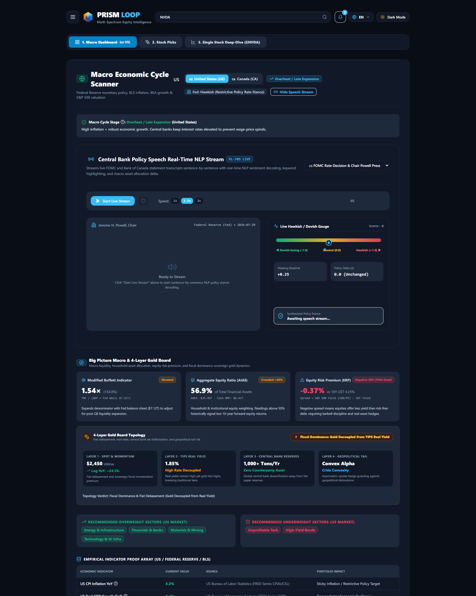
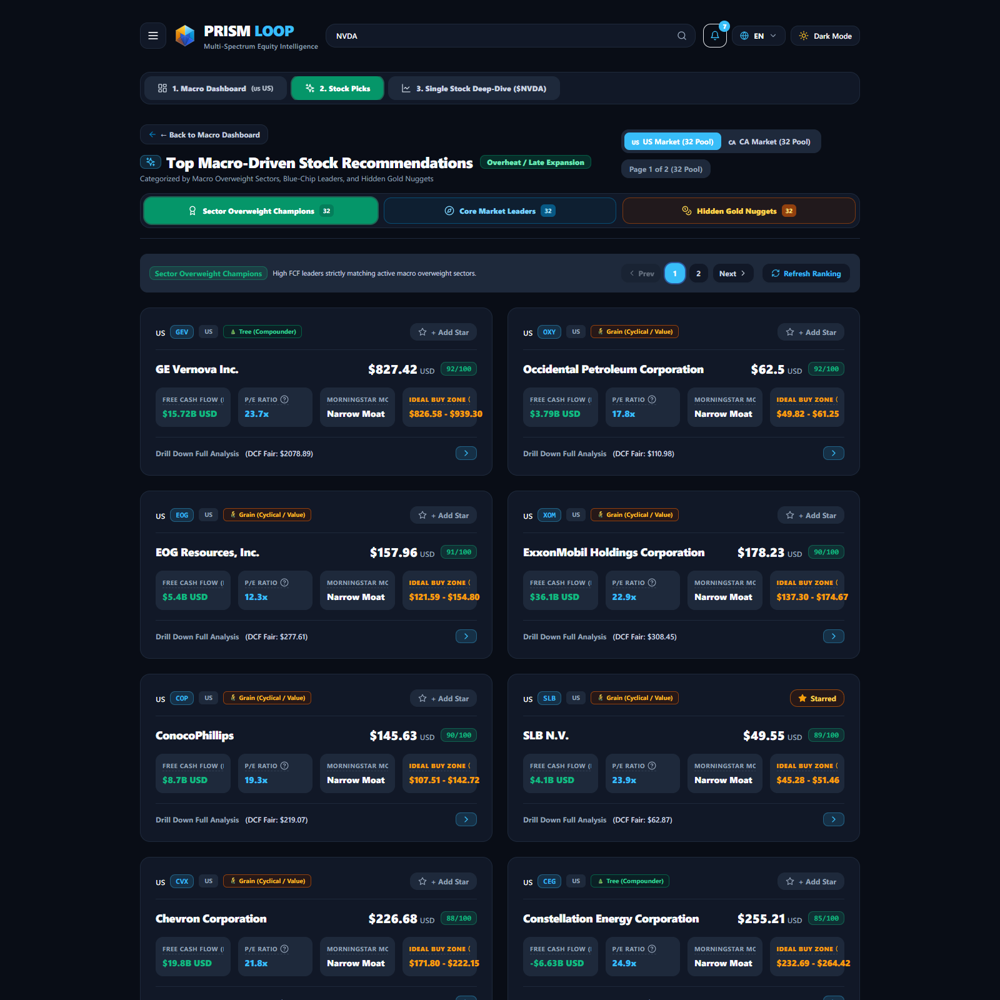
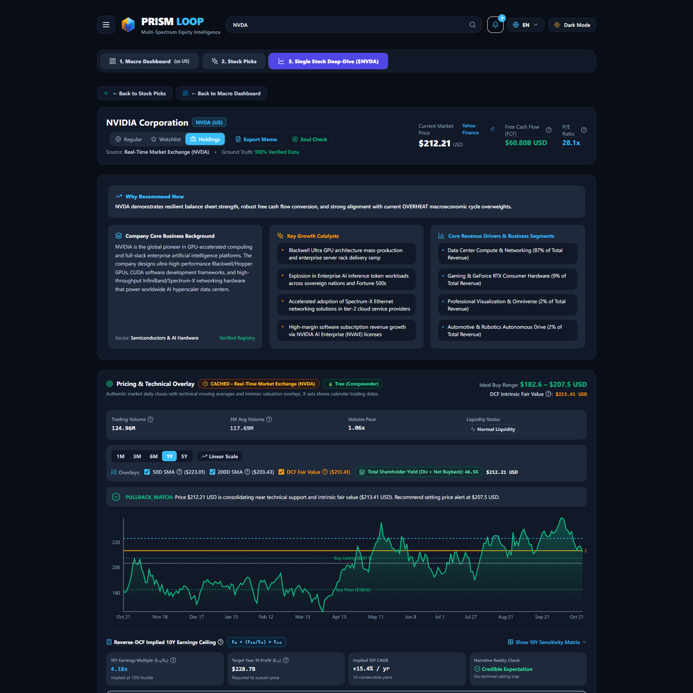
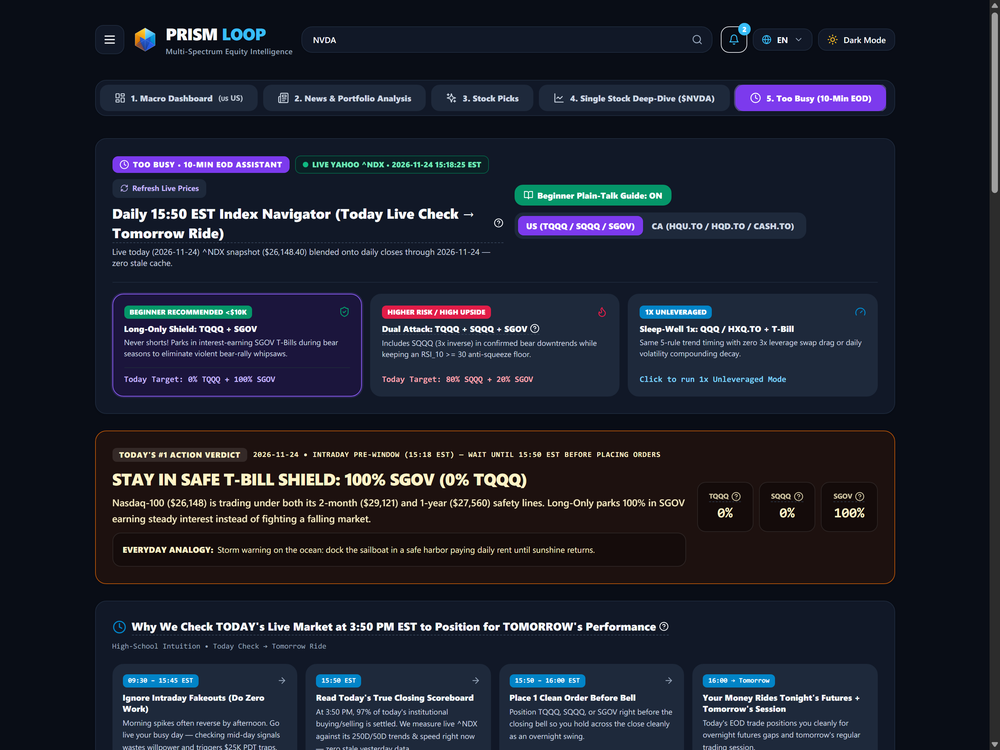
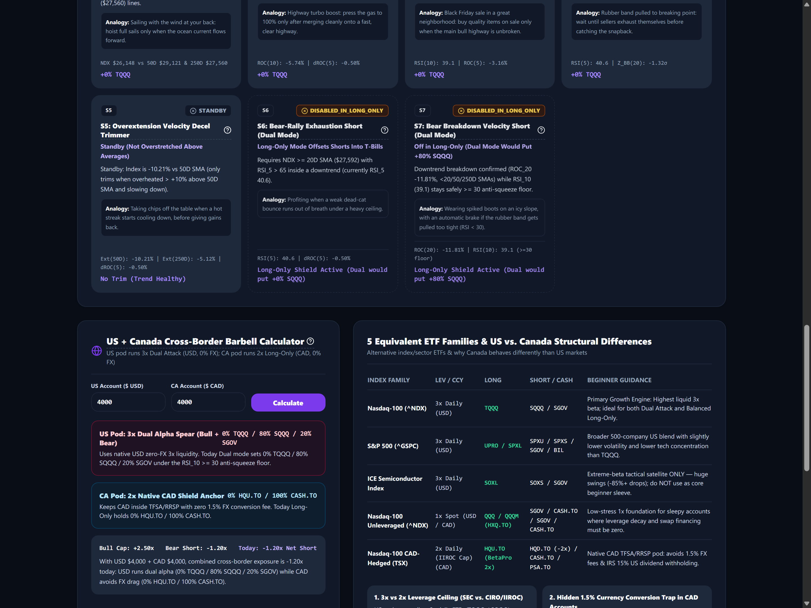

# Prism Loop: Multi-Spectrum Equity & Systematic Index Intelligence Workstation

[English](README.md) | [简体中文](README.zh-CN.md)

[](https://github.com/edzhangcan/ai-investment/tags)
[](backend/tests)
[](LICENSE)
[](#)
[](#)
[](#)

Prism Loop is a desktop-grade equity research and systematic portfolio workstation built for self-directed investors across US (NYSE/NASDAQ) and Canadian (TSX/TSXV) markets. It combines fundamental valuation, 5-year SEC 10-K / SEDAR+ text mining, real-time FOMC & Bank of Canada speech streaming, multi-agent adversarial debates, 3-bucket portfolio tracking, and a **100% decoupled 10-Minute End-of-Day Index Navigator (`Too Busy`)** designed for busy schedules and small accounts (`<$10K`).

Rather than reading hundreds of pages of boilerplate filings or relying on ungrounded AI summaries that invent metrics, investors use Prism Loop to compute mathematical buy zones, surface 5-business-day portfolio catalysts, enforce clear holding discipline, and manage systematic `15:50 EST` index allocations in under 10 minutes a day.

---

## Workstation Previews

### Tab 1: Macro Dashboard & On-Demand Central Bank Speech Streamer
Live macroeconomic cycle classification, Big Picture systemic metrics (Modified Buffett Indicator, AIAE, ERP), 4-layer gold topology, and on-demand FOMC / Bank of Canada policy speech NLP streaming.



### Tab 3: 3-Bucket Stock Tracking & Dynamic Portfolio Valuation
Lifecycle management divided into **Holdings**, **Watchlist**, and **Regular Discoveries** with live valuations, integer & fractional share support, total return tracking, and real-time portfolio weighting.



### Tab 4: Technical Overlay, Holdings-Aware Kill-Switch & Reverse-DCF
Interactive price charts overlaying 50-day / 200-day SMAs, DCF fair value brackets, adaptive stop floors, and Reverse-DCF implied 10-year earnings expectations.



### Tab 5: Standalone "Too Busy" 10-Min EOD Index Navigator (`PL-733` / `PL-734`)
Beginner-first decision cockpit featuring an App-Launch Daily Signal Banner, side-by-side **Balanced Long-Only (`TQQQ + SGOV`)** vs. **Aggressive Dual Attack (`TQQQ + SQQQ + SGOV`)** tracks, Plain-Talk everyday analogies, a high-school `3:50 PM Today → Tomorrow` timeline, and a 4-Key-Signal traffic-light checklist synced to live Yahoo Finance quotes.



### Cross-Border Two-Account Barbell & 5-Family ETF Matrix
Combines a US `3x Dual` pod (`USD`, 0% FX) and a Canadian `2x Long-Only` pod (`CAD` native `HQU.TO / CASH.TO` in TFSA/RRSP) alongside 5 alternative index/sector ETF families and a `<$10K` SELL-before-BUY whole-share ticket solver.



---

## Core Architecture (5-Tab Workstation)

### 1. Macro Cycle Scanner & On-Demand Central Bank Policy Streamer (Tab 1)
- **On-Demand Central Bank Speech Streaming**: Streams Federal Reserve (FOMC) and Bank of Canada (BoC) policy remarks via Server-Sent Events (SSE) on request with sentence-level NLP sentiment scoring.
- **Business Cycle Classification**: Maps CPI inflation, policy rates, and 10Y–2Y spreads into Expansion, Slowdown, Contraction, or Recovery.
- **Systemic & Gold Telemetry**: Tracks the Modified Buffett Indicator, AIAE, ERP, and 4-layer Gold Topology (spot momentum, TIPS decoupling, sovereign central bank reserve buying, geopolitical risk).

### 2. News & Portfolio Intelligence Briefing (`PL-732` — Tab 2)
- **5-Business-Day Portfolio Catalysts & Risks**: Filters actionable catalysts and risks strictly within `<= 5` business days tied to `HOLDING` and `WATCHLIST` positions across US and Canadian markets.
- **18 US & Canadian Institutional Investor Desks**: Curated coverage including major Canadian (Giverny, Mawer, EdgePoint, CPPIB, OTPP, Burgundy) and US fundamental managers, with clickable source attribution links.
- **Full-Width Hero Action Advice**: Consolidates per-position pulse cards (`HOLD CORE`, `WATCH PULLBACK`, `DEFEND FLOOR`, `SCALE IN READY`, `TRIM EXTENDED`) across English, Simplified Chinese, and Hybrid views.

### 3. 3-Bucket Stock Lifecycle & Dynamic Portfolio Valuation (Tab 3)
- **Holdings**: Supports both integer and fractional share counts, calculating live market value, unrealized P&L, and real-time portfolio weights without arbitrary allocation ceilings.
- **Watchlist & Regular Discoveries**: Alerts at 95% proximity for Watchlist targets and 90% fair-value discount with moving-average stabilization guards to prevent falling-knife entries.
- **Holdings-Only Adaptive Kill-Switch (`PL-730`)**: Enforces adaptive falsification stops (`COST_BASIS_ATR_STOP`, `RECOVERY_SUPPORT_STOP`, `STRUCTURAL_200D_STOP`) and pre-trade commitment checks.

### 4. Universal Valuation Engine 2.0, Multi-Agent Debate & Filing Miner (Tab 4)
- **Business-Model-Matched Valuation**: Tailors DCF, PB-ROE, Excess Return, Normalized Mid-Cycle FCF, and Regulated Utility DDM formulas by corporate archetype, plus 24h fundamentals caching (`PL-731`).
- **Reverse-DCF Penetration**: Derives the 10-year implied earnings multiple and required CAGR baked into current share prices.
- **Multi-Agent Debate & 5-Year Text Miner**: Runs structured Bull vs. Bear vs. CIO verdicts and compares 5 years of SEC EDGAR / SEDAR+ MD&A disclosures for hidden guidance deletions or litigation risks.

### 5. Standalone "Too Busy" 10-Min EOD Systematic Tool (`PL-733` / `PL-734` — Tab 5)
Built **100% outside and decoupled from core single-stock engines** (`too_busy_engine.py`, `too_busy_guide.py`, `too_busy.py`):
- **Single-Source `S1`–`S7` Engine**: Evaluates `^NDX` daily price-action across trend (`50D/250D SMA`), momentum velocity (`ROC/dROC`), oversold dips (`Wilder RSI`), 20D reclaim pivots, parabolic deceleration trims (`S5`), and tactical bear shorts (`S6`/`S7` with `RSI(10) >= 30` anti-squeeze floor).
- **Beginner Explanation Mode**: Toggleable **`Beginner Plain-Talk Guide: ON / OFF`** with `<BilingualHoverCard>` tooltips and daily-life analogies across 16 entries in `frontend/data/jargon_dictionary.json`.
- **Real-Time Feeds & No-Cache Refresh**: `30s`/`60s` live quote TTLs, `Cache-Control: no-store` headers, one-click **Refresh Live Prices** (on both Tab 5 and the App-Launch Daily Signal Banner), and `60s` open-market auto-polling.
- **Small-Account (`<$10K`) Whole-Share Solver**: Sequences `SELL` orders before `BUY` orders, applies a `10%` hysteresis filter to curb churn, verifies `$25K` PDT exemption (all trades occur once daily at `15:50 EST` and hold overnight), and audits US Taxable wash-sale and Canadian `1.5%` FX conversion traps.
- **US + Canada Cross-Border Barbell & Honest Backtester**: Models dual-account exposure (`USD 3x Dual` + `CAD 2x Long-Only`) and runs multi-decade `^NDX` backtests deducting `2x` historical Fed Funds borrowing drag, `0.95%` expense ratio, and `5 bps` turnover slippage.

---

## Additional Capabilities

- **App-Launch Daily Signal Banner**: Surfaces today's `15:50 EST` action signal, exact order preview, live market freshness stamp, and inline refresh trigger immediately on app startup.
- **Trilingual Interface (`EN` / `中` / `中/EN`)**: Instant switching with plain-talk tooltips and WCAG AAA high-contrast Light & Dark themes.
- **Discord Webhooks & A4 Print Memos**: Push daily macro briefs and valuation triggers directly to Discord, or export clean white-background A4 research memos.
- **Lazy Code-Splitting (`PL-731`)**: Tab-level `React.lazy` bundles keep initial entry chunks small and responsive.

---

## Quick Start

### Prerequisites
- **Python**: 3.11 or newer
- **Node.js**: 18.0 or newer
- **Operating Systems**: Windows, macOS, or Linux

### Option 1: 1-Click Launch (Recommended)

#### Windows
1. Double-click `install.bat` once to install backend and frontend dependencies.
2. Double-click `start.bat` to launch both backend and frontend servers. Open `http://localhost:3000`.

#### macOS / Linux
```bash
chmod +x install.sh start.sh
./install.sh
./start.sh
```

### Option 2: Manual Terminal Setup

```powershell
# 1. Start the FastAPI backend server (http://127.0.0.1:8000)
python -m venv backend/venv
.\backend\venv\Scripts\pip install -r backend/requirements.txt
$env:PYTHONPATH="."
.\backend\venv\Scripts\python -m uvicorn backend.main:app --host 127.0.0.1 --port 8000

# 2. In a second terminal window, start the Vite React dev server (http://localhost:3000)
cd frontend
npm install
npx vite --port 3000 --host
```

---

## Project Structure

```text
ai-investment/
├── backend/
│   ├── agents/               # Multi-Agent Debate Arena (Bull, Bear, CIO)
│   ├── data_sources/         # Live market feeds, news/investor feeds, SEC EDGAR, SEDAR+
│   ├── engines/              # Macro, DCF Pricing, News Portfolio, TooBusyEngine & TooBusyGuide
│   ├── routers/              # REST & SSE endpoints (macro, news_portfolio, stock, debate, too_busy, alerts)
│   └── tests/                # 262 automated pytest cases across core & standalone suites
├── frontend/
│   ├── data/                 # Bilingual glossary & everyday analogies (jargon_dictionary.json)
│   ├── src/
│   │   ├── components/       # Workstation tabs, TooBusyView + too-busy/*, Launch Banner, Charts, Modals
│   │   ├── api/              # Typed no-store API clients
│   │   ├── i18n/             # EN / ZH / Hybrid translations
│   │   ├── utils/            # Memo printing, formatters, math helpers
│   │   └── types/            # TypeScript contracts
│   └── vite.config.ts
├── docs/
│   ├── too_busy_analysis/    # Standalone "Too Busy" analysis, PRD, and roadmap suite
│   └── screenshots/          # Workstation interface screenshots
├── install.bat / install.sh
└── start.bat / start.sh
```

---

## Automated Verification

Run backend verification suites:
```powershell
$env:PYTHONPATH="."
.\backend\venv\Scripts\python.exe -m pytest backend/tests/test_pl733_too_busy_engine.py -v
.\backend\venv\Scripts\python.exe -m pytest backend/tests/ -v
```

Validate frontend TypeScript types and build production bundles:
```powershell
cd frontend
node .\node_modules\typescript\bin\tsc --noEmit
npm run build
```

---

## Methodology Acknowledgments

Core value-investing principles and valuation guardrails in Prism Loop draw inspiration from:
- **《面基》 (Mianji Podcast)**: Concepts for the Qualified Holder framework (*只做合格持有人*), Bayesian updating (*贝叶斯更新*), the Three-Part Equity Taxonomy (*树/粮/菜*), and pre-trade rules (*《纪律.md》*).
- **老钱日日谈 & Open Research Repositories**: Reverse-DCF narrative penetration (*穿透叙事*), systemic macro indicator boards (*美股看板*), and 4-layer gold topology (*黄金看板*).

---

## License

Distributed under the MIT License. See [LICENSE](LICENSE) for full details.
