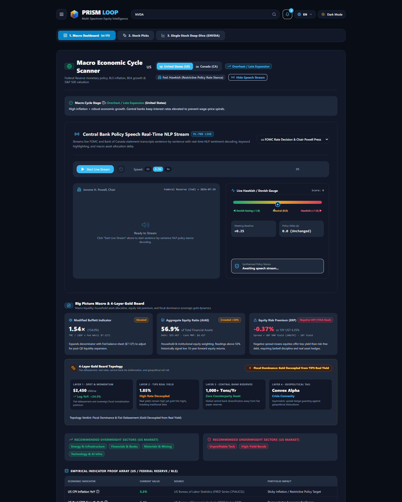
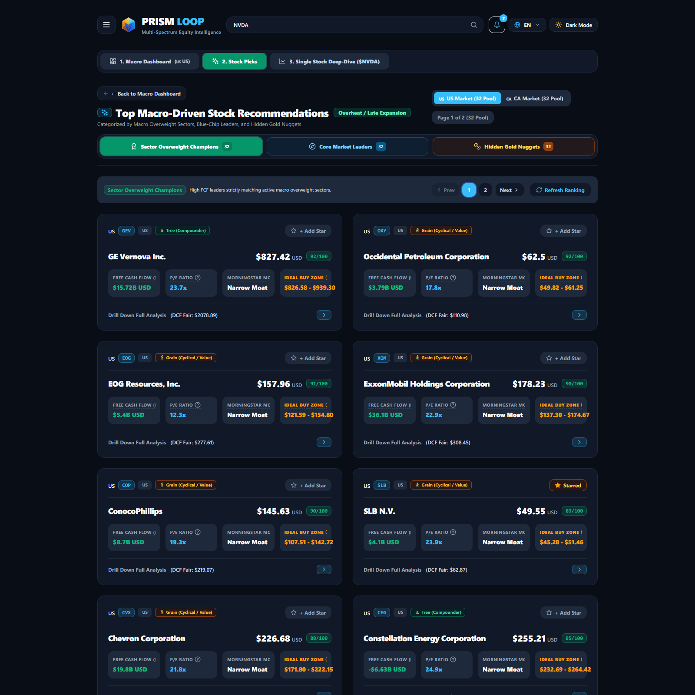
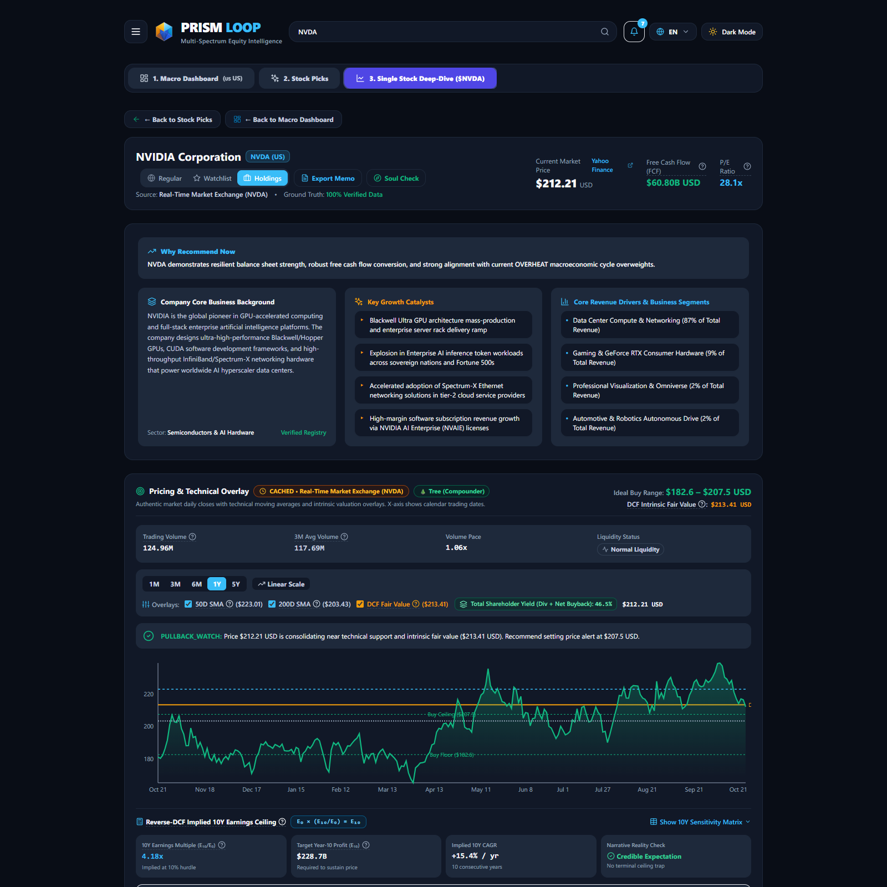

# Prism Loop: Multi-Spectrum Equity Intelligence Workstation

[English](README.md) | [简体中文](README.zh-CN.md)

[](https://github.com/edzhangcan/ai-investment/tags)
[](backend/tests)
[](LICENSE)
[](#)
[](#)
[](#)

Prism Loop is a desktop-grade equity research workstation built for self-directed investors in US and Canadian markets. It integrates live exchange price feeds, macroeconomic indicators, 5-year SEC 10-K and SEDAR+ filing text diffs, multi-agent AI debates, real-time central bank speech streaming, discounted cash flow (DCF) valuation, and disciplined portfolio tracking into a single interface.

Rather than reading hundreds of pages of boilerplate filings or relying on ungrounded AI summaries that invent financial metrics, investors use Prism Loop to compute mathematical buy zones, test bear theses, and enforce clear holding discipline before deploying capital.

---

## Why Prism Loop

Most retail tools provide backward-looking accounting ratios or generic AI chat prompts that cannot verify numbers. Professional investment desks analyze assets across multiple independent dimensions:

1. **Macro cycle alignment**: Is the business operating with or against prevailing interest rate and inflation cycles?
2. **Central bank policy trajectory**: How do Federal Reserve and Bank of Canada policy announcements influence systemic liquidity and discount rates?
3. **Disclosure changes**: Did management quietly drop forward revenue guidance or introduce new litigation liabilities in its latest annual report?
4. **Adversarial stress testing**: What is the most credible bear thesis, and what happens if valuation multiples revert to their historical mean?
5. **Valuation margin of safety**: What is the highest entry price that still produces an acceptable risk-adjusted return?
6. **Holding discipline**: When should an investor sell rather than average down on a broken business?

Prism Loop automates this workflow across 135+ benchmark North American equities and any custom ticker you search.

---

## Workstation Previews

### Macro Scanner and Central Bank Speech Streamer
Real-time central bank policy streaming with sentence-by-sentence NLP sentiment scoring, 4-layer gold topology, and empirical macroeconomic indicators from the Federal Reserve and the Bank of Canada.



### 3-Bucket Stock Tracking and Dynamic Portfolio Valuation
Lifecycle management divided into Holdings, Watchlist, and Regular Discoveries with live valuations, total return tracking, and real-time portfolio weight calculations.



### Technical Overlay, Buy Zones, and Reverse-DCF
Interactive price charts showing 50-day and 200-day moving averages, DCF fair value bands, and Reverse-DCF calculations showing the 10-year implied earnings multiple and required compound annual growth rate.



---

## Core Architecture

### 1. 3-Bucket Stock Lifecycle and Portfolio Valuation
Organizes monitored equities into three explicit operational states:
- **Holdings**: Tracks actively held positions. Users specify total shares owned and purchase price. The system continuously recalculates position market value, unrealized profit and loss percentage, and portfolio allocation weighting ($\text{Stock Market Value} / \text{Portfolio Total Market Value}$). Investors can add shares to existing holdings at any time without artificial suggested allocation limits.
- **Watchlist**: Monitored candidates with defined target purchase prices. The alert engine triggers an entry notification when the market price comes within 5% of the target purchase price (95% proximity threshold). Moving an equity into the Watchlist automatically removes it from the unvetted discoveries list.
- **Regular (Deep Value Discoveries)**: System-generated candidate opportunities identified by fundamental filters. Alerts require a 10% discount below fair value (90% threshold) and technical stabilization above moving averages to avoid falling-knife traps.

### 2. Holding Discipline and Falsification Kill-Switch
Protects capital by replacing emotional reactions with predetermined mathematical rules:
- **Structural Exit Floor**: Flags an urgent exit alert if a holding breaks below its 200-day simple moving average multiplied by 0.97 ($200\text{D SMA} \times 0.97$).
- **Anti-Averaging Down Guardrail**: Blocks recommendations to add capital to a position whose core fundamental thesis or technical floor has failed.
- **Pre-Trade Thesis Commitment**: Interactive check dialog requires investors to write down their core investment premise, expected catalysts, and explicit falsification conditions before executing an entry.

### 3. Macro Cycle Scanner and Central Bank Policy Streamer
Tracks systemic market conditions across both the United States and Canada:
- **Central Bank Speech Streaming**: Transmits live transcripts from the Federal Reserve (FOMC) and the Bank of Canada (BoC) over Server-Sent Events (SSE). Applies natural language processing to assign sentence-level sentiment scores and track policy stance shifts against prior baselines.
- **Business Cycle Classification**: Categorizes the macroeconomic backdrop into Expansion, Slowdown, Contraction, or Recovery using FRED and Bank of Canada economic series (CPI inflation, policy rates, 10Y-2Y yield curve spreads).
- **Big Picture Macro Indicators**: Evaluates systemic equity valuations using the Modified Buffett Indicator (expanded to account for post-QE central bank balance sheet assets), Aggregate Equity Ratio (AIAE), and Equity Risk Premium (ERP).
- **4-Layer Gold Topology**: Evaluates gold price drivers across spot momentum, TIPS real yield decoupling, foreign central bank gold accumulation, and sovereign geopolitical tail risk.

### 4. Universal Valuation Engine 2.0 and Reverse-DCF
Tailors valuation models to distinct corporate business structures:
- **Capital Goods and Cyclicals**: Normalized mid-cycle operating cash flows with replacement capital expenditure adjustments.
- **Payment Networks**: High-conversion cash tollbooth models with minimal reinvestment requirements.
- **Financial Institutions**: PB-ROE and Excess Return models that treat customer deposits as raw inventory rather than financial debt.
- **Regulated Utilities and Infrastructure**: Rate-base Dividend Discount Models (DDM) pegged to authorized return on equity.
- **Secular Growth Platforms**: Multi-stage discounted cash flow models with margin expansion curves.
- **200-Day SMA Support Guardrail**: Anchors buy brackets to institutional cost basis levels when quality compounders consolidate near major moving averages.
- **Reverse-DCF Narrative Reality Check**: Computes the 10-year implied earnings multiple ($E_0 \times (E_{10}/E_0) = E_{10}$) and 10-year required earnings CAGR needed to justify the current stock price, identifying cases where market expectations exceed realistic business limits.

### 5. Multi-Agent Bull vs. Bear Debate Arena
Subject each analyzed company to a structured debate between specialized AI personas:
- **Bull Case Advocate**: Formulates the growth thesis, focusing on competitive advantages, unit economics, return on invested capital, and secular industry tailwinds.
- **Bear Case Prosecutor**: Identifies vulnerabilities, including customer concentration, refinancing risks, margin erosion, and technical breakdown patterns.
- **Chief Investment Officer (CIO)**: Reviews both presentations, calculates an authentic risk-reward ratio, and issues a final verdict (BUY, ACCUMULATE, WATCHLIST, or PASS) along with maximum portfolio allocation boundaries.

### 6. Longitudinal Filing Text Miner (SEC EDGAR and SEDAR+)
Conducts longitudinal word count and sentiment comparisons across five consecutive years of annual MD&A filings:
- Detects newly inserted risk factors and legal disclosures.
- Identifies guidance deletions where management quietly removed previous revenue or margin targets.
- Measures executive tone shifts across reporting periods.

---

## Additional Capabilities

- **Sub-50ms Live Market Feeds**: Direct ingestion for US (NYSE, NASDAQ) and Canadian (TSX, TSXV) stocks with a 3-minute in-memory cache.
- **Notification Center**: Bell icon with real-time unread badges, item dismissal, and one-click navigation directly to affected stock analysis tabs.
- **Direct Discord Webhooks**: Delivers daily macro briefs and target price alerts directly to a designated Discord channel without external cloud subscriptions.
- **Bilingual Interface and Terminology Cards**: Instant toggling between English (`EN`), Simplified Chinese (`中`), and Hybrid (`中/EN`). Financial metrics include interactive hover cards with clear plain-language explanations.
- **Clean A4 Research Memo Printing**: Generates white-background research memos without navigation chrome, formatted for PDF archiving and physical printing.
- **Lean Dependency Footprint**: Built with Vite and native browser animations, ensuring rapid page loads and minimal bundle sizes.

---

## Quick Start

### Prerequisites
- **Python**: 3.11 or newer
- **Node.js**: 18.0 or newer
- **Supported Operating Systems**: Windows, macOS, or Linux

### Option 1: 1-Click Launch (Recommended)

#### Windows
1. Double-click `install.bat` once to install backend and frontend dependencies.
2. Double-click `start.bat` to launch both backend and frontend servers. Your default browser will open `http://localhost:3000`.

#### macOS / Linux
```bash
chmod +x install.sh start.sh
./install.sh
./start.sh
```

### Option 2: Manual Terminal Setup

```powershell
# 1. Start the FastAPI backend server (http://127.0.0.1:8000)
python -m venv backend/venv
.\backend\venv\Scripts\pip install -r backend/requirements.txt
$env:PYTHONPATH="."
.\backend\venv\Scripts\python backend/main.py

# 2. In a second terminal window, start the React dev server (http://localhost:3000)
cd frontend
npm install
npm run dev
```

---

## Project Structure

```
ai-investment/
├── backend/                  # FastAPI service and analytical engines
│   ├── agents/               # Multi-Agent Debate Arena (Bull, Bear, CIO)
│   ├── data_sources/         # Real-time exchange feeds, SEC EDGAR, SEDAR+, Profiles
│   ├── engines/              # Macro, DCF Pricing, Fundamentals, Filing Miner, Central Bank Streamer
│   ├── routers/              # REST and SSE API endpoints (macro, stock, debate, speech, alerts)
│   └── tests/                # 195 automated pytest verification test cases
├── frontend/                 # React 18, TypeScript, and Vite user interface
│   ├── src/
│   │   ├── components/       # UI cards, debate arena, charts, modals, notification center
│   │   ├── context/          # Language and global workstation context providers
│   │   ├── utils/            # Memo printing, export utilities, math formatters
│   │   └── types/            # TypeScript interfaces and API contract models
│   └── vite.config.ts        # Vite configuration and Rollup chunk splitting
├── docs/                     # Specifications, design system guidelines, and architecture diagrams
│   └── screenshots/          # Workstation interface captures and design assets
├── install.bat / install.sh  # Automated dependency installation scripts
└── start.bat / start.sh      # Automated workstation startup scripts
```

---

## Automated Verification

Run backend regression tests:
```powershell
$env:PYTHONPATH="."
.\backend\venv\Scripts\python -m pytest backend/tests/ -v
```

Validate frontend TypeScript types and build production bundles:
```powershell
npm --prefix frontend run build
```

---

## Methodology Acknowledgments

The investment principles, risk guardrails, and valuation frameworks in Prism Loop draw inspiration from:
- **《面基》 (Mianji Podcast)**: Concepts for the Qualified Holder framework (*只做合格持有人*), Bayesian updating (*贝叶斯更新*), the Three-Part Equity Taxonomy (*树/粮/菜: Trees, Grain, Vegetables*), and pre-trade rules (*《纪律.md》*).
- **老钱日日谈与开源投研资料库**: Methodologies for Reverse-DCF narrative penetration (*穿透叙事*), macroeconomic tracking frameworks (*美股看板*), and the 4-layer gold topology (*黄金看板*).

---

## License

Distributed under the MIT License. See [LICENSE](LICENSE) for full details.
