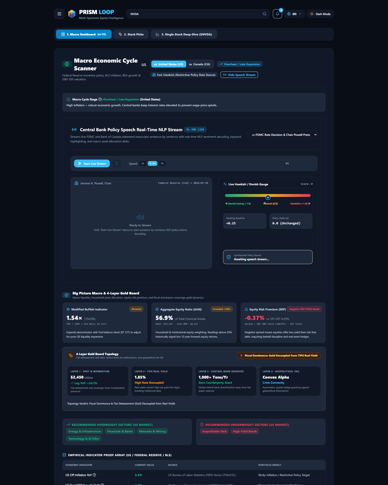
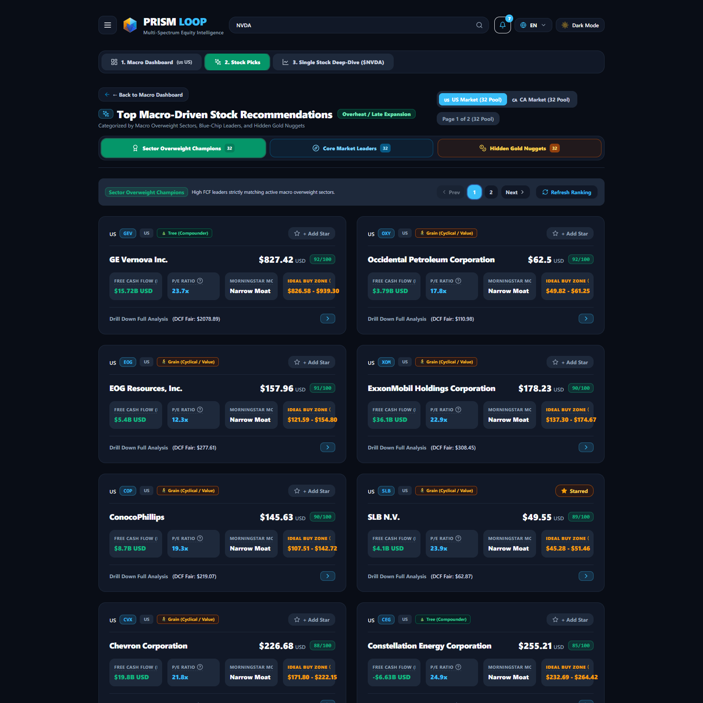
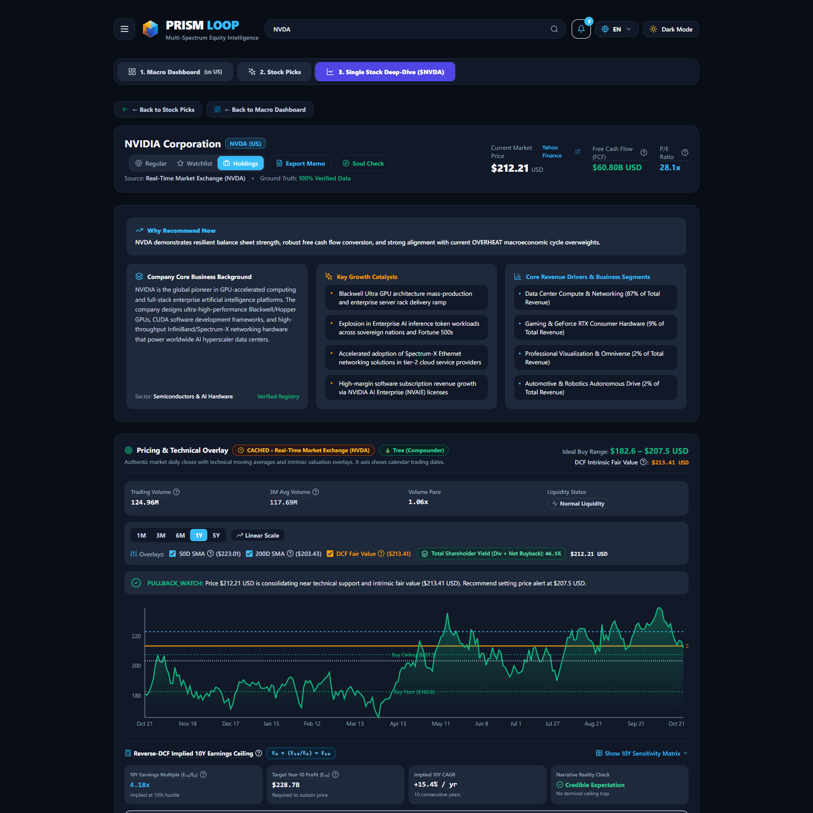
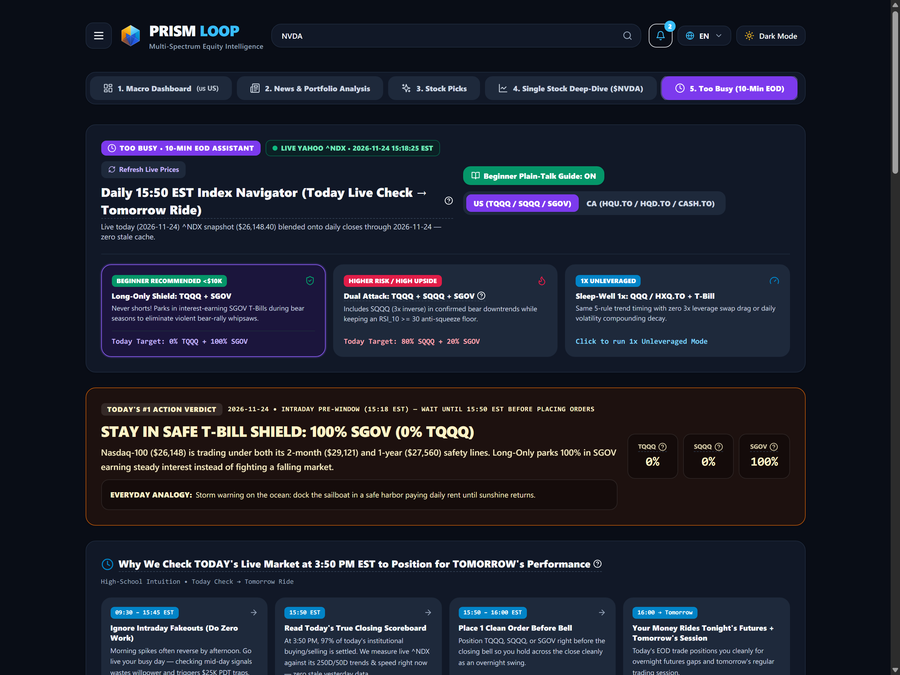
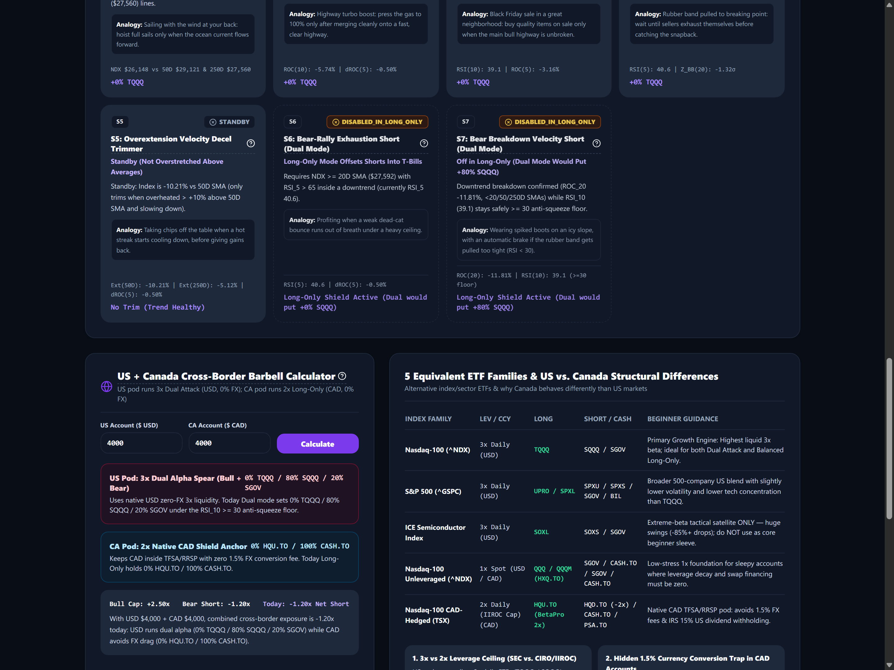

# Prism Loop: 多维光谱智能投研与尾盘指数导航工作站

[English](README.md) | [简体中文](README.zh-CN.md)

[](https://github.com/edzhangcan/ai-investment/tags)
[](backend/tests)
[](LICENSE)
[](#)
[](#)
[](#)

Prism Loop 是一款面向美股（NYSE/NASDAQ）与加股（TSX/TSXV）自主投资者的桌面级多维投研工作站。在一个响应迅捷的统一界面中，融合了宏观周期扫描、美加投资新闻与超级投资者智库精简简报、3 状态股票生命周期、SEC 10-K 与 SEDAR+ 连续 5 年年报文本差异挖掘、多智能体对抗辩论、DCF 估值引擎，以及**100% 独立解耦的 `Too Busy` 每日 10 分钟尾盘指数导航系统**（专为忙碌上班族与 `<$10K` 小资金打造）。

---

## 工作站界面预览

### Tab 1：宏观周期扫描仪与按需央行实时流
美联储（FOMC）与加拿大央行（BoC）政策声明按需流式 NLP 情绪打分、修正巴菲特指标、AIAE 与 4 层黄金拓扑看板。



### Tab 3：3 状态股票生命周期与动态组合估值
按**持仓库（Holdings）**、**自选池（Watchlist）**与**常规发现池（Regular）**清晰划分，支持整数股与零碎股精确核算、累计盈亏与实时组合权重。



### Tab 4：技术均线叠加、动态斩仓护盾与 Reverse-DCF
交互式技术图表叠加 50 日 / 200 日均线、DCF 安全边际估值区间、基于成本/支撑位的动态防守止损线，以及 Reverse-DCF 十年隐含复合增速推导。



### Tab 5：独立 `"Too Busy"` 每日 10 分钟尾盘指数导航 (`PL-733` / `PL-734`)
极简新手友好决策舱：含开屏每日操作信号横幅、**稳健长多护盾 (`TQQQ + SGOV`)** 与 **激进双向进攻 (`TQQQ + SQQQ + SGOV`)** 双路线同屏对比、大白话生活比喻开关、“今天 15:50 评估 → 明天行情收益”高中生级可视化时间线，以及直连 Yahoo Finance 实时行情的 4 大红绿灯体检清单。



### 美加跨市场双账户联动计算器与 5 大同类 ETF 矩阵
支持美国账户（`USD 3x 双向`，0% 换汇损耗）与加拿大原生账户（`CAD 2x 纯多 HQU.TO + CASH.TO` 避税账户）联动仓位与净杠杆计算，并对照展示 5 大同类可替代 ETF 家族与 `<$10K` 先卖后买整数股调仓计算器。



---

## 五大核心功能模块

### 1. 宏观周期扫描与按需央行实时流 (Tab 1)
- **按需央行政策文本流**：采用 Server-Sent Events (SSE) 按需流式解析 FOMC 与加拿大央行讲话，逐句量化鹰鸽倾向。
- **宏观周期与黄金拓扑**：追踪 CPI 通胀、美债 10Y–2Y 利差、修正巴菲特指标、AIAE 与 4 层黄金定价逻辑。

### 2. 投资新闻与持仓简报引擎 (`PL-732` — Tab 2)
- **5 个工作日超短时效催化与风险**：严格限定展示 `<= 5` 个工作日内与用户持仓/自选强相关的真实催化剂与风险，并附可点击原始信源链接。
- **18 家美加机构投研席位**：覆盖 Giverny、Mawer、EdgePoint、CPPIB、OTPP、Burgundy 等北美顶尖价值管理机构。
- **全宽英雄区行动建议**：支持英文、中文及中英双语的仓位行动标签与执行提示。

### 3. 3 状态股票生命周期与持仓防守纪律 (Tab 3)
- **整数股与碎股支持**：持仓库实时核算市值与真实比重；自选池（95% 阈值）与发现池（90% 深度折价 + 均线企稳防接飞刀）。
- **持仓专属动态证伪止损 (`PL-730`)**：结合持仓成本与 ATR / 200 日结构支撑生成防守止损下限，阻止趋势破位后盲目摊平成本。

### 4. 通用估值引擎 2.0、多智能体对抗与年报文本挖掘 (Tab 4)
- **分商业模式估值 + 24 小时基本面缓存 (`PL-731`)**：为周期制造、支付网络、银行保险、公用事业与成长股自动匹配模型。
- **多智能体对抗与 5 年 MD&A 纵向差异**：由多头先锋、空头检察官与 CIO 输出风险收益比裁决，并自动识别 SEC EDGAR / SEDAR+ 年报指引删除与新增诉讼。

### 5. 独立 `"Too Busy"` 每日 10 分钟尾盘指数导航 (`PL-733` / `PL-734` — Tab 5)
**100% 独立解耦**构建（[`too_busy_engine.py`](backend/engines/too_busy_engine.py)、[`too_busy_guide.py`](backend/engines/too_busy_guide.py)、[`too_busy.py`](backend/routers/too_busy.py)），绝不干扰原有单票与宏观核心引擎：
- **单一数据源 `S1`–`S7` 量化核心**：实盘与多年代回测共享一套无漂移规则引擎（50/250 日趋势、ROC/dROC 动量速率、Wilder RSI 超卖低吸、20 日线右侧收复、S5 超涨减速止盈、以及 S6/S7 含 `RSI_10 >= 30` 防轧空底线的熊市双向做空）。
- **新手大白话与生活比喻模式**：支持一键开关 **`新手大白话+生活比喻`**，并内置 16 条 `<BilingualHoverCard>` 交互式术语词典（[`jargon_dictionary.json`](frontend/data/jargon_dictionary.json)）。
- **实时行情直连与无缓存刷新**：30 秒 / 60 秒超短缓存 + `Cache-Control: no-store` 强制禁缓存响应头 + Tab 5 与启动横幅一键 **立即刷新实时行情** 按钮 + 盘中每 60 秒自动轮询。
- **小账户 (`<$10K`) 整数股调仓与风控审计**：自动 **先卖后买** 释放现金，支持 `10%` 迟滞过滤减少无效换手；严格 `15:50 EST` 尾盘下单隔夜持有，100% 豁免 `$25K` 美股 PDT 日内交易限制，并提示美股应税洗售及加元 1.5% 换汇损耗。
- **美加跨市场双账户联动与真实融资回测**：联动测算美元 3 倍双向与加元 2 倍护盾净敞口，并在长期回测中全额扣除 2 倍联邦基金利率融资成本、0.95% 管理费与 5 bps 滑点。

---

## 快速启动

### 环境准备
- **Python**: 3.11 或更高版本
- **Node.js**: 18.0 或更高版本
- **支持系统**: Windows、macOS、Linux

### 方式一：一键脚本启动（推荐）
- **Windows**: 双击 `install.bat` 安装依赖，随后双击 `start.bat` 并访问 `http://localhost:3000`。
- **macOS / Linux**:
```bash
chmod +x install.sh start.sh
./install.sh
./start.sh
```

### 方式二：手动终端启动
```powershell
# 1. 启动后端 FastAPI 服务 (http://127.0.0.1:8000)
python -m venv backend/venv
.\backend\venv\Scripts\pip install -r backend/requirements.txt
$env:PYTHONPATH="."
.\backend\venv\Scripts\python -m uvicorn backend.main:app --host 127.0.0.1 --port 8000

# 2. 在第二个终端启动前端 Vite 服务 (http://localhost:3000)
cd frontend
npm install
npx vite --port 3000 --host
```

---

## 自动化测试验证

```powershell
# 运行 Too Busy 独立引擎专项回归测试
$env:PYTHONPATH="."
.\backend\venv\Scripts\python.exe -m pytest backend/tests/test_pl733_too_busy_engine.py -v

# 运行全量测试套件
.\backend\venv\Scripts\python.exe -m pytest backend/tests/ -v

# 校验 TypeScript 与生产构建
cd frontend
node .\node_modules\typescript\bin\tsc --noEmit
npm run build
```

---

## 开源协议

基于 MIT 开源协议发布。详情请查阅 [LICENSE](LICENSE)。
